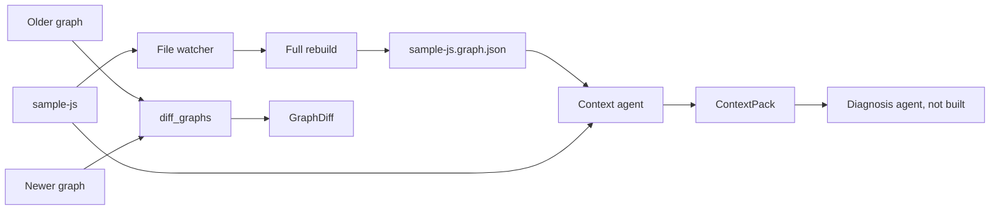
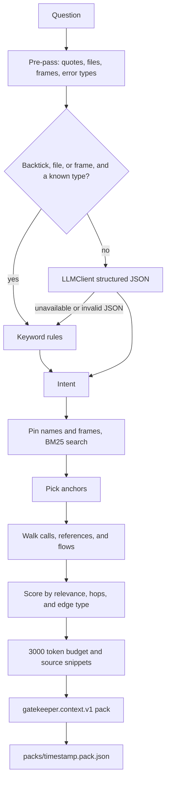
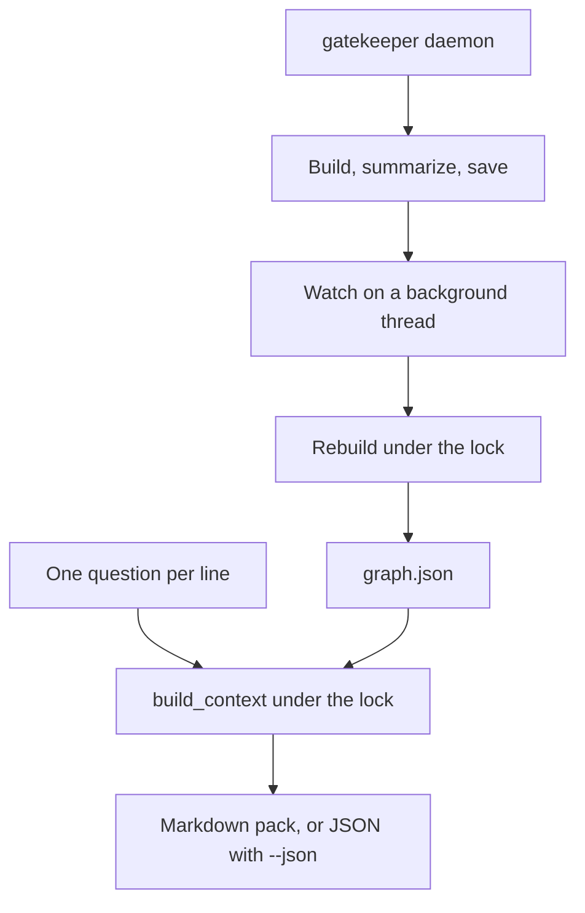
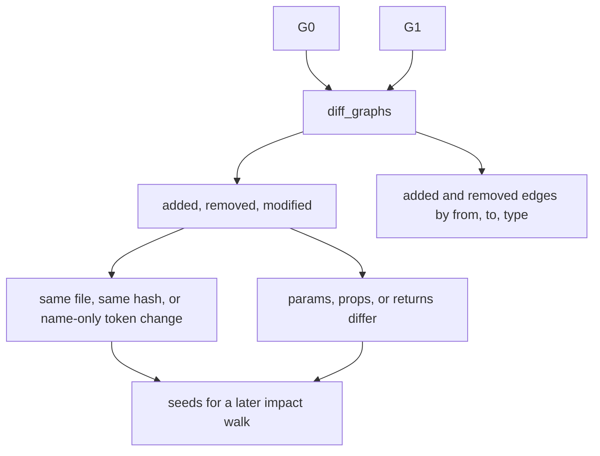

# GateKeeper

`sample-js` is a small till app. `gatekeeper-graph` reads it and builds a knowledge graph. `gatekeeper-data` holds that graph. The scanner does not write into `sample-js`.

Run every `uv` command from `gatekeeper-graph`. That directory is the Python project. A command started in `gatekeeper-data` still loads `gatekeeper-graph\.env`, but relative paths such as `tests\fixtures\shop` only work from `gatekeeper-graph`.

Last check of `gatekeeper-graph` on 2026-11-11: `ruff` clean, `mypy` clean, **113 passed, 3 skipped**. The skipped tests call a live model and run only when that model is configured.

## Engineering decisions

| Decision | Why |
| --- | --- |
| The scanned repo is read-only. Graphs, packs, and indexes go in `gatekeeper-data` or another `--out` path outside the repo. | A watcher must not rewrite the code it is scanning. `--out` inside the repo exits 2. |
| Nodes and edges come from tree-sitter only. The model writes summaries and, for a vague question, an `Intent`. It never invents a node id. | A wrong model reply cannot add a call or an import that the parser did not see. |
| Every edge carries `file` and `line`. No evidence, no edge. | Later impact and diagnosis can point at the line that created the link. |
| The graph is one sorted JSON file, schema version 2. There is no database and no timestamp in the file. | The same tree produces the same bytes, so tests can compare graphs. |
| `flows_into` is stored value to consumer (`DISCOUNT_RATE` to `applyDiscount`). Walks use `dependency_ends`, `dependencies()`, and `users()`, which flip that edge. | Callers of a constant are downstream. The constant itself is upstream context. |
| One `LLMClient`. Providers are `ollama_http`, `langchain_ollama`, and `langchain_groq`. This project uses Groq. | Summaries, intent, and `llm-check` share timeouts, stats, and failure types. |
| The Groq key is only `GROQ_API_KEY` in the environment. It is not a config field, not in logs, and not in git. | `gatekeeper-graph\.env` is gitignored. `.env.example` lists the names. |
| `.env` fills missing variables from the current directory, then from the directory that contains `pyproject.toml`. A variable already set in the shell wins. | `gatekeeper daemon` works when the shell is in `gatekeeper-data`. |
| `watch` rebuilds the whole repo. It does not patch one file. | The resolver needs the whole import graph. Incremental rebuild is not built. |
| The context agent classifies a question and fetches a pack. It does not diagnose or edit. | Diagnosis is a later agent. Until it exists, the pack is written to `packs/<timestamp>.pack.json`. |
| `daemon` holds one lock across a rebuild and a question. | A question never reads a graph file while it is being replaced. |
| `diff_graphs` ignores a hash change on a file or module node unless that file exists in only one graph. | Those nodes are hashed from the whole file, so a one-function edit would otherwise mark the file and the module. |
| A rename whose text hash changed is still a rename when one added and one removed symbol in that file share a signature and literals, and their tokens differ only by the two names. | The hash includes the function name, so `titleCase` to `toTitle` is not an equal-hash rename. |
| Tests copy `tests/fixtures/shop`. They do not read or write `sample-js`. | The live till app can be edited without moving the golden graph. |

Config precedence for the model is built-in defaults, then `[llm]` in `./gatekeeper.toml`, then `GATEKEEPER_LLM_PROVIDER`, `GATEKEEPER_LLM_MODEL`, and `GATEKEEPER_LLM_BASE_URL`. The code default is local Ollama with `qwen2.5-coder:3b`. This checkout selects Groq with `langchain_groq` and `qwen/qwen3.8-27b`. More detail is in `gatekeeper-graph/docs/llm.md` and `gatekeeper-graph/docs/context.md`.

## Phases

| Phase | What landed | State |
| --- | --- | --- |
| Fixtures | `shop` copy of the till app, `react_mini`, golden `shop.graph.json` | Done |
| Parser | tree-sitter for JS and TS, 1-based lines outside the parser, `.d.ts` skipped | Done |
| Models | Schema v2 `Node`, `Edge`, `Graph`, stable JSON | Done |
| Extractor | Files, modules, symbols, hashes, signatures, tokens, literals | Done |
| Resolver | Relative imports, `jsconfig` aliases, barrels, calls, references, `flows_into` | Done |
| Build and store | `gatekeeper build`, atomic write, reverse index, term search | Done |
| LLM | `LLMClient`, Ollama HTTP, LangChain Ollama, LangChain Groq, `FakeClient` | Done |
| Watch | 300ms debounce, full rebuild, summaries reused when the hash matches | Done |
| Context agent | `Intent`, BM25 shortlist, expand, rank, budget, `ContextPack` | Done |
| Daemon | One process for the live index and stdin questions | Done |
| Direction fix | `flows_into` walks go from the consumer toward the value | Done |
| Graph diff | `diff_graphs` for added, removed, modified, renamed, signature, edges | Done |
| Impact view | Affected subgraph, must-change status, checks, `changes.jsonl`, browser | Not started |
| Diagnosis and edit | Root cause and a code edit | Not started |

## Architecture



`gatekeeper daemon` is the indexer and the context agent in one process. `diff_graphs` is a library function. Nothing calls it on save yet.

## Build and watch

```mermaid
flowchart TD
  files["JS and TS files"] --> parse["tree-sitter parse"]
  parse --> extract["symbols, imports, exports, calls, references, flows"]
  extract --> resolve["relative paths, jsconfig aliases, barrels"]
  resolve --> graph["schema v2 graph.json"]
  events["File created, modified, deleted, or moved"] --> debounce["300ms debounce"]
  debounce --> parse
  graph --> summaries["symbol, then file, then module summaries"]
  summaries --> save["atomic replace of the graph file"]
```

`gatekeeper build` walks the repo once and does not call a model. `gatekeeper watch` writes the graph immediately, then rebuilds the whole repo. After each rebuild it fills summaries through `LLMClient` and keeps a summary when the content hash is unchanged. One save can emit several events; they are grouped for 300ms. Changes under `node_modules`, `dist`, `build`, `.git`, `coverage`, `.next`, `.turbo`, and `out` are ignored.

The graph is schema version 2. Node ids look like `src/main.js#checkout`, `module:src/main.js`, and `external:react`. Symbol nodes carry `tokens`, `literals`, `summary`, and `summary_hash`. Edges include `contains`, `imports`, `calls`, `references`, `flows_into`, and `unresolved`. `calls` edges also store `args`. JSON is sorted and has no timestamps.

A symbol hash is the text of that symbol. A file hash and a module hash are the whole file, with newlines normalized and trailing spaces removed. A blank line therefore changes the file hash and not the symbol hash. `diff_graphs` treats that as no change.

## Context agent

The context agent does two things and then stops. It does not diagnose, rank root causes, write an answer, or edit code.



An explicit question, one that names `checkout` in backticks or includes a file or stack frame, is classified with keywords and does not call the model. A vague question goes to the model. If the model is down, keyword rules are used and `fallback_reason` says why. The model may only pick numbers from the shortlist.

A Windows path is recognized when it ends at `.js` or `.ts` even if a Node stack trace is glued to it. A path whose slashes were stripped still matches a repo file such as `src/main.js`. `package.json` is not treated as `package.js`.

Missing summaries, literals, `references` edges, `flows_into` edges, `search_index.json`, `changes.jsonl`, or `tests.json` do not crash the agent. Each gap is listed on the pack. Nothing writes `changes.jsonl` yet, so the pack reports `no_changes_file`.

## Daemon



The first lines are the provider, the model, and the graph write. Then type a question and press Enter. An empty line is ignored. `quit`, Ctrl+C, or closing the input stops the watcher. `--budget 3000` is the default. The same client is used for summaries and questions. If the model is down, summaries are skipped and a question still gets the rules pack.

## Graph diff



`modified` is a symbol whose hash changed. A line move with the same hash is not a modification. `signature_changed` is the subset of `modified` whose parameters, props, or return type changed. Edges are compared by source, target, and type, so a line move does not add and remove the same call. There is no `gatekeeper diff` command yet. The function is `gatekeeper_graph.graph_diff.diff_graphs`.

## How to run

From `gatekeeper-graph`:

```powershell
cd C:\Users\anilk\Desktop\coding\Visualize\gatekeeper-graph
uv sync --extra langchain
```

Groq settings are read from `gatekeeper-graph\.env` when a command starts, including when the shell is in `gatekeeper-data`. A variable already set in the terminal wins. The key is not written into source, logs, or git.

```powershell
uv run gatekeeper llm-check
```

`llm-check` exits 0 when Groq answers, 2 when it is unavailable, and 3 when the JSON does not match the schema.

Build the live graph without a model:

```powershell
uv run gatekeeper build C:\Users\anilk\Desktop\coding\Visualize\sample-js --out C:\Users\anilk\Desktop\coding\Visualize\gatekeeper-data\sample-js.graph.json
```

Watch the till app and store summaries:

```powershell
uv run gatekeeper watch C:\Users\anilk\Desktop\coding\Visualize\sample-js --out C:\Users\anilk\Desktop\coding\Visualize\gatekeeper-data\sample-js.graph.json
```

Ctrl+C stops `watch`.

Index the repo and answer questions in one process:

```powershell
uv run gatekeeper daemon C:\Users\anilk\Desktop\coding\Visualize\sample-js --out C:\Users\anilk\Desktop\coding\Visualize\gatekeeper-data\sample-js.graph.json
```

The first line should be `provider=langchain_groq model=qwen/qwen3.8-27b`. Ask a question at `question>`. Do not type a `node` command there. In PowerShell, a backtick inside double quotes is an escape, so a question that contains a backtick belongs in single quotes when it is passed as an argument.

Inspect and search the graph:

```powershell
uv run gatekeeper show C:\Users\anilk\Desktop\coding\Visualize\gatekeeper-data\sample-js.graph.json --kind function
uv run gatekeeper show C:\Users\anilk\Desktop\coding\Visualize\gatekeeper-data\sample-js.graph.json --node src/receipt.js#lineFor
uv run gatekeeper search C:\Users\anilk\Desktop\coding\Visualize\gatekeeper-data\sample-js.graph.json titleCase
```

Classify a question. `--json` prints one `gatekeeper.analyse.v1` document. A bad path prints `{"ok": false, "error": "..."}` and exits 2.

```powershell
uv run gatekeeper analyse C:\Users\anilk\Desktop\coding\Visualize\gatekeeper-data\sample-js.graph.json "the receipt shows customer names in the wrong case" --json
```

Build a context pack. `--md` prints ranked nodes, paths, snippets, and gaps. `--json` prints one `gatekeeper.context.v1` document. `--root` is the repo the snippets are read from, and it is required.

```powershell
uv run gatekeeper context C:\Users\anilk\Desktop\coding\Visualize\gatekeeper-data\sample-js.graph.json "the receipt shows customer names in the wrong case" --root C:\Users\anilk\Desktop\coding\Visualize\sample-js --md
```

The same command also writes `gatekeeper-data\packs\<timestamp>.pack.json`. `--out pack.json` writes a second copy. `--budget 3000` is the default token budget. `--file src/receipt.js` adds that file when it exists in the graph. `--write-index` stores `search_index.json` beside the graph.

The shop fixture is the copy tests use. It does not require the live `sample-js` tree:

```powershell
uv run gatekeeper analyse tests\fixtures\golden\shop.graph.json 'explain `checkout`' --json
uv run gatekeeper context tests\fixtures\golden\shop.graph.json 'explain `checkout`' --root tests\fixtures\shop --md
```

See a graph diff on a temporary copy of `sample-js`. The real tree is not edited. `modified` should be `src/utils/string.js#titleCase`.

```powershell
uv run python -c @'
from pathlib import Path
import shutil, tempfile
from gatekeeper_graph.builder import build_graph
from gatekeeper_graph.graph_diff import diff_graphs

src = Path(r"C:\Users\anilk\Desktop\coding\Visualize\sample-js")
copy = Path(tempfile.mkdtemp()) / "sample-js"
shutil.copytree(src, copy)
before = build_graph(src).graph
path = copy / "src" / "utils" / "string.js"
text = path.read_text(encoding="utf-8").replace("toUpperCase", "toLowerCase")
path.write_text(text, encoding="utf-8")
diff = diff_graphs(before, build_graph(copy).graph)
print("modified", diff.modified)
print("signature_changed", diff.signature_changed)
'@
```

Run the till app in a separate terminal. Quote the path so the backslashes stay intact:

```powershell
node "C:\Users\anilk\Desktop\coding\Visualize\sample-js\src\main.js"
```

Check the package:

```powershell
uv run ruff check .
uv run mypy
uv run pytest -q
```

## Commands

| Command | What it does |
| --- | --- |
| `build <root> --out <graph>` | Parse the repo and write the graph. No model call. |
| `watch <root> --out <graph>` | Rebuild on file events and fill summaries. |
| `daemon <root> --out <graph> [--json] [--budget N]` | Keep the graph live and answer questions from stdin. |
| `show <graph> [--kind KIND] [--node ID]` | Print nodes, or one node's edges and dependents. |
| `search <graph> <query>` | Print node ids from the in-graph term index. |
| `llm-check` | Call the configured model once and print `CallStats`. |
| `analyse <graph> "<question>" [--file PATH] [--json]` | Return an `Intent`. |
| `context <graph> "<question>" --root <repo> [--md \| --json] [--budget N] [--out FILE]` | Return a `ContextPack`. |
| `eval-intent <graph> [--set PATH] [--json]` | Score the labelled shop questions. |
| `eval-context <fixture> [--json]` | Plant bugs in a temp copy and print recall. |

## What is implemented

```mermaid
flowchart TB
  subgraph done [Implemented]
    parse["JS and TS parser"]
    graph["Schema v2 graph, references, flows, search terms"]
    watch["Watch and full rebuild"]
    summaries["Summaries on watch"]
    context["Intent and ContextPack"]
    daemon["Daemon: index plus questions"]
    graphDiff["diff_graphs"]
  end
  subgraph later [Not implemented]
    jsx["JSX render, prop, hook, context, and test edges"]
    incremental["Rebuild only the changed file"]
    impact["Impact subgraph, checks, changes.jsonl, viewer"]
    diagnosis["Diagnosis agent"]
  end
  done --> graphFile["sample-js.graph.json"]
  later --> graphFile
```

Implemented in `gatekeeper-graph`:

- Parser for `.js`, `.jsx`, `.mjs`, `.cjs`, `.ts`, `.mts`, `.cts`, and `.tsx`. `.d.ts` is skipped. Line numbers outside the parser are 1-based.
- Extractor and resolver for files, modules, symbols, imports, re-exports, calls, references, and value flow. Relative imports, `jsconfig` aliases, and barrel re-exports resolve. Unresolved dynamic imports stay on an `unresolved` edge.
- Atomic graph writes, a reverse index, and `gatekeeper search` over names, paths, summaries, tokens, and literals.
- Summaries on watch: symbols first, then file nodes, then module nodes. A failed model call keeps the previous summary and sets `stale`.
- Context agent under `src/gatekeeper_graph/context/`. Tests live in `tests/context/` and use `tests/fixtures/shop`, not the live `sample-js` path.
- `gatekeeper daemon` runs the indexer and the context agent together. It watches the repo and reads questions from stdin.
- `diff_graphs` compares two in-memory graphs. Six shop-fixture tests cover a body edit, a line shift, a rename, a signature change, a deletion, and no change.

Not implemented:

- JSX render, prop, hook, context, and test edges. `react_mini` is only a fixture. The edge type names exist, and the resolver does not emit those edges.
- Incremental rebuilds. `watch` rebuilds the whole repo.
- The impact view: affected subgraph, must-change and review status, parse and test checks, `impact/latest.json`, `changes.jsonl`, and `gatekeeper view`.
- The diagnosis agent. The hand-off writes a pack file. A later agent can register a handler.

## sample-js

Vanilla ESM, no dependencies. `checkout` sums the prices, takes 10% off (`DISCOUNT_RATE`), then adds 8% tax (`TAX_RATE`). The header passes the string `CUSTOMER` (`"ada lovelace"`) through `titleCase`, so the greeting is `Hello Ada Lovelace (3 items)`. Prices are converted with `Number` before `toFixed` and before the sum, so the muffin price `"2.50"` is numeric. The printed total is `Till: $17.01 Daily Total`. `titleCase` is re-exported through `src/utils/index.js`. `loadExtra` dynamically imports `./math.js`, and that import stays unresolved in the graph. `src/kmp.js` still begins with the bare identifier `ReadableStreamDefaultController`.

Source files:

- `src/main.js`
- `src/constants.js`, `src/math.js`, `src/format.js`
- `src/receipt.js`, `src/customer.js`, `src/summary.js`
- `src/utils/string.js`, `src/utils/join.js`, `src/utils/index.js`
- `src/kmp.js`
