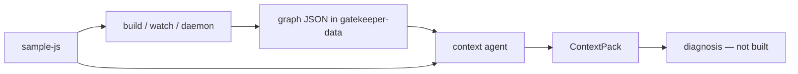
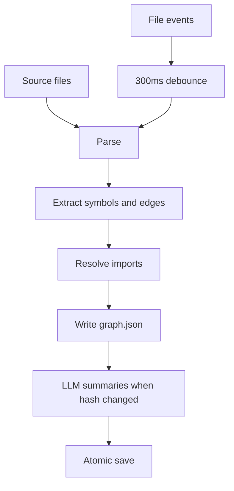
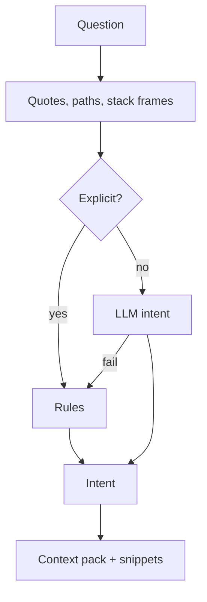
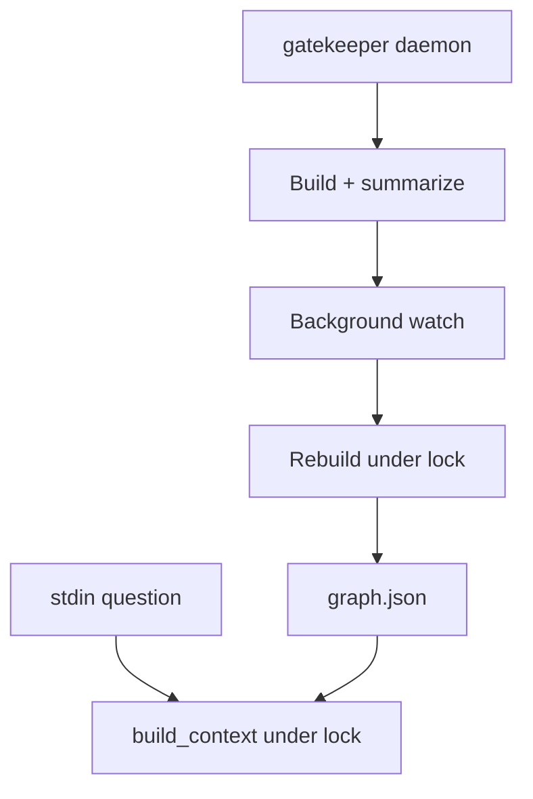

# GateKeeper

Three folders:

| Folder | Role |
| --- | --- |
| `sample-js` | Small till app (read-only for the scanner) |
| `gatekeeper-graph` | Python project — run all `uv` commands here |
| `gatekeeper-data` | `sample-js.graph.json`, packs, indexes |

**Tests (2026-11-11):** ruff and mypy clean, **113 passed**, 3 skipped (live Groq only).

**Model:** Groq via `gatekeeper-graph\.env` (`GATEKEEPER_LLM_*`, `GROQ_API_KEY`). The key is gitignored. Shell vars override `.env`. Loading also works when your cwd is `gatekeeper-data`.

---

## What it does today



| Done | Not built yet |
| --- | --- |
| Parse JS/TS, build schema v2 graph, watch + summaries | Impact view, `changes.jsonl`, browser |
| Question → `Intent` → `ContextPack` | Diagnosis agent, code edits |
| `gatekeeper daemon` (watch + stdin questions) | Incremental rebuild, JSX edges |
| `diff_graphs` (library only, not on save) | |

---

## Phases (build history)

| # | Phase | Status |
| --- | --- | --- |
| 1 | Fixtures, parser, models, extractor, resolver | Done |
| 2 | `build`, store, LLM layer, `watch` | Done |
| 3 | Context agent (`analyse`, `context`) | Done |
| 4 | Daemon, `flows_into` direction, `diff_graphs` | Done |
| 5 | Impact view, diagnosis | Planned |

---

## Key rules (short)

- **Read-only scan** — output never goes inside the repo (`--out` inside the repo exits 2).
- **Structure from tree-sitter** — the model only adds summaries and (for vague questions) intent JSON, never new node ids.
- **Evidence** — every edge has `file` + `line`.
- **One graph file** — sorted JSON, schema v2, no DB.
- **`flows_into`** — stored as value → consumer; walks use `dependencies()` / `users()` so callers of a constant count as downstream.
- **Context agent** — fetches context only; packs go to `packs/<timestamp>.pack.json`.
- **Tests** — use `tests/fixtures/shop`, not live `sample-js`.

More: [gatekeeper-graph/docs/llm.md](gatekeeper-graph/docs/llm.md), [gatekeeper-graph/docs/context.md](gatekeeper-graph/docs/context.md).

---

## Flow: build and watch



`build` = one pass, no model. `watch` = full rebuild on each burst of saves (not per-file incremental).

Node id examples: `src/main.js#checkout`, `module:src/main.js`. Edges: `calls`, `imports`, `references`, `flows_into`, `unresolved`, …

---

## Flow: context agent



Explicit = backticks, file path, or stack frame plus a known problem type → **no LLM**. Otherwise Groq (or rules if unavailable).

Paste a **Node error** at `question>` in daemon (not a `node ...` shell command). Paths like `src/main.js` in a stack are recognized.

---

## Flow: daemon



Type `quit` or Ctrl+C to stop. `--json` for JSON packs.

---

## Graph diff (`diff_graphs`)

Compare two in-memory graphs: added / removed / modified symbols, renames, `signature_changed`, edge add/remove. **No CLI yet.** File/module nodes are skipped unless the file only exists on one side (so a one-line body edit does not flag the whole file).

---

## Quick start

```powershell
cd C:\Users\anilk\Desktop\coding\Visualize\gatekeeper-graph
uv sync --extra langchain
uv run gatekeeper llm-check
```

**One process — index + ask questions:**

```powershell
uv run gatekeeper daemon C:\Users\anilk\Desktop\coding\Visualize\sample-js --out C:\Users\anilk\Desktop\coding\Visualize\gatekeeper-data\sample-js.graph.json
```

**Build graph only (no LLM):**

```powershell
uv run gatekeeper build C:\Users\anilk\Desktop\coding\Visualize\sample-js --out C:\Users\anilk\Desktop\coding\Visualize\gatekeeper-data\sample-js.graph.json
```

**Context pack (separate terminal):**

```powershell
uv run gatekeeper context C:\Users\anilk\Desktop\coding\Visualize\gatekeeper-data\sample-js.graph.json "explain checkout" --root C:\Users\anilk\Desktop\coding\Visualize\sample-js --md
```

Use single quotes around the question when it contains backticks (PowerShell).

**Run the till app:**

```powershell
node "C:\Users\anilk\Desktop\coding\Visualize\sample-js\src\main.js"
```

**Quality:**

```powershell
uv run ruff check .
uv run mypy
uv run pytest -q
```

---

## Commands

| Command | Purpose |
| --- | --- |
| `build` / `watch` | Graph file; watch adds summaries |
| `daemon` | Watch + questions on stdin |
| `show` / `search` | Inspect saved graph |
| `llm-check` | Probe configured model |
| `analyse` / `context` | Intent or full pack |
| `eval-intent` / `eval-context` | Regression on shop fixture |

---

## sample-js

ESM till: discount 10%, tax 8%, receipt lines via `titleCase`. After recent fixes: `header` uses `CUSTOMER` as a string, prices coerced with `Number`, `checkout(label, prices)` argument order corrected. Expected run output includes `Hello Ada Lovelace (3 items)` and `Till: $17.01 Daily Total`.
