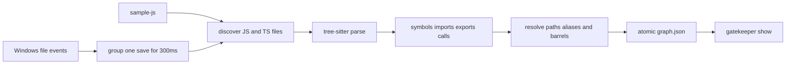
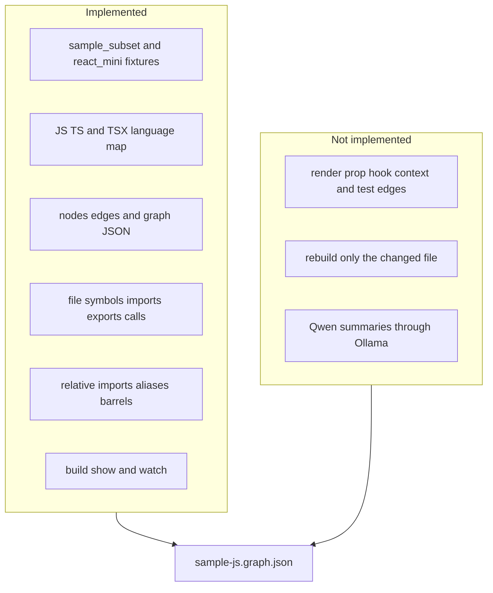

# GateKeeper graph work so far

This folder holds three separate pieces. `sample-js` is the small till app that gets scanned. `gatekeeper-graph` reads that app and writes a knowledge graph. `gatekeeper-data` holds the graph JSON. The scanner does not write into `sample-js`.

Last check of `gatekeeper-graph`: `ruff`, `mypy`, and `pytest` passed, 30 tests, on 2026-11-06.

## What runs



`gatekeeper build` walks that path once. `gatekeeper watch` writes the graph immediately, then runs the same full build again when Windows reports `created`, `modified`, `deleted`, or `moved`. The sleep loop only keeps the process alive. Changes under `node_modules`, `dist`, `build`, `.git`, `coverage`, `.next`, `.turbo`, and `out` are ignored.

## Commands

From `gatekeeper-graph`:

```powershell
uv run gatekeeper build C:\Users\anilk\Desktop\coding\Visualize\sample-js --out C:\Users\anilk\Desktop\coding\Visualize\gatekeeper-data\sample-js.graph.json

uv run gatekeeper watch C:\Users\anilk\Desktop\coding\Visualize\sample-js --out C:\Users\anilk\Desktop\coding\Visualize\gatekeeper-data\sample-js.graph.json

uv run gatekeeper show C:\Users\anilk\Desktop\coding\Visualize\gatekeeper-data\sample-js.graph.json --node src/main.js#checkout
```

`--out` inside the scanned repo exits with code 2. Ctrl+C stops `watch`.

Run the till app itself with:

```powershell
node C:\Users\anilk\Desktop\coding\Visualize\sample-js\src\main.js
```

## How far the graph goes



Implemented in `gatekeeper-graph`:

- Fixtures copied for tests: `tests/fixtures/sample_subset` and `tests/fixtures/react_mini`. Tests do not point at the real `sample-js` path.
- Parser: `.js`, `.jsx`, `.mjs`, `.cjs`, `.ts`, `.mts`, `.cts`, and `.tsx`. `.d.ts` is skipped. Line numbers outside the parser are 1-based.
- Model: node ids like `src/main.js#checkout` and `external:react`. Graph JSON is sorted and has no timestamps.
- Extractor: file and symbol nodes, `contains`, static imports, re-exports, dynamic `import()`, and calls. A `useName` function is a hook. A PascalCase function that contains JSX is a component.
- Resolver: relative files, `jsconfig`/`tsconfig` path aliases, barrel re-exports, and package names such as `react-dom/client` becoming `external:react-dom`. Unresolved imports keep the raw specifier. Calls whose first name is not bound are dropped.
- Store: write a temp file, fsync, then replace the graph file.
- CLI: `build` prints every edge. `watch` prints one summary line and rewrites the same file. `show` prints nodes, or one node's outgoing edges, incoming edges, and dependents.
- Reverse index: for the edge types above, plus room for render, hook, context, prop, and test edges when those exist.

The current `sample-js` graph records files, constants, functions, imports, calls, the `titleCase` barrel re-export, and the unresolved dynamic `import("./math.js")`. `summary` is empty and `stale` is true.

Not implemented yet:

- Edges for JSX renders, props, context, hooks, and tests. `react_mini` is only a fixture. The model names those edge types, and the resolver does not emit them.
- Incremental updates. `incremental.py` is empty. `watch` rebuilds the whole repo.
- Qwen summaries. `summarizer.py` is empty. Nothing calls Ollama.

## sample-js

Vanilla ESM, no dependencies. `checkout` sums prices, takes 10% off, then adds 8% tax. The receipt header greets Ada Lovelace. Current source files:

- `src/main.js`
- `src/constants.js`, `src/math.js`, `src/format.js`
- `src/receipt.js`, `src/customer.js`, `src/summary.js`
- `src/utils/string.js`, `src/utils/join.js`, `src/utils/index.js`
