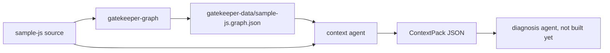
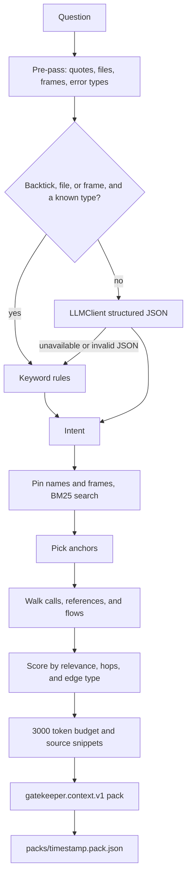

# GateKeeper

This folder has three pieces. `sample-js` is a small till app. `gatekeeper-graph` reads that app and answers questions about it. `gatekeeper-data` holds the graph file. The scanner does not write into `sample-js`.

Run every `uv` command from `gatekeeper-graph`. That directory is the Python project. Running them from `gatekeeper-data` makes `uv` miss the environment and makes relative paths point at the wrong place.

Last check of `gatekeeper-graph` on 2026-11-06: `ruff` clean, `mypy` clean, **95 passed, 3 skipped**. The skipped tests call Groq and run only when the environment below is set.

## Layout



## Build and watch

```mermaid
flowchart TD
  files["JS and TS files"] --> parse["tree-sitter parse"]
  parse --> extract["symbols, imports, exports, calls, references, flows"]
  extract --> resolve["relative paths, jsconfig aliases, barrels"]
  resolve --> graph["schema v2 graph.json"]
  events["Windows file events"] --> debounce["300ms debounce"]
  debounce --> parse
  graph --> summaries["symbol, file, then module summaries"]
  summaries --> save["atomic replace of the graph file"]
```

`gatekeeper build` walks the repo once and does not call a model. `gatekeeper watch` writes the graph immediately, then rebuilds the whole repo when Windows reports `created`, `modified`, `deleted`, or `moved`. After each rebuild it fills summaries through `LLMClient` and keeps a summary when the content hash is unchanged. One save can emit several events; they are grouped for 300ms. Changes under `node_modules`, `dist`, `build`, `.git`, `coverage`, `.next`, `.turbo`, and `out` are ignored. `--out` inside the scanned repo exits 2.

The graph is schema version 2. Node ids look like `src/main.js#checkout`, `module:src/main.js`, and `external:react`. Symbol nodes carry `tokens`, `literals`, `summary`, and `summary_hash`. Edges include `contains`, `imports`, `calls`, `references`, `flows_into`, and `unresolved`. JSON is sorted and has no timestamps.

## Context agent

The context agent does two things and then stops. It does not diagnose, rank root causes, write an answer, or edit code.



An explicit question, one that names `checkout` in backticks or includes a file or stack frame, is classified with keywords and does not call the model. A vague question goes to the model. If Groq is down, keyword rules are used and `fallback_reason` says why. The model may only pick numbers from the shortlist. It never invents node ids.

Missing summaries, literals, `references` edges, `flows_into` edges, `search_index.json`, `changes.jsonl`, or `tests.json` do not crash the agent. Each gap is listed on the pack.

## How to run

From `gatekeeper-graph`:

```powershell
cd C:\Users\anilk\Desktop\coding\Visualize\gatekeeper-graph
uv sync --extra langchain
```

Groq is selected only by the environment. The key is not stored in config, source, or logs.

```powershell
$env:GATEKEEPER_LLM_PROVIDER = "langchain_groq"
$env:GATEKEEPER_LLM_MODEL = "qwen/qwen3.8-27b"
$env:GROQ_API_KEY = "<your key>"
uv run gatekeeper llm-check
```

`llm-check` exits 0 when Groq answers, 2 when it is unavailable, and 3 when the JSON does not match the schema.

Build the live graph without a model:

```powershell
uv run gatekeeper build C:\Users\anilk\Desktop\coding\Visualize\sample-js --out C:\Users\anilk\Desktop\coding\Visualize\gatekeeper-data\sample-js.graph.json
```

Watch the till app and store summaries:

```powershell
uv run gatekeeper watch C:\Users\anilk\Desktop\coding\Visualize\sample-js --out C:\Users\anilk\Desktop\coding\Visualize\gatekeeper-data\sample-js.graph.json
```

Ctrl+C stops `watch`.

Inspect and search that file:

```powershell
uv run gatekeeper show C:\Users\anilk\Desktop\coding\Visualize\gatekeeper-data\sample-js.graph.json --kind function
uv run gatekeeper show C:\Users\anilk\Desktop\coding\Visualize\gatekeeper-data\sample-js.graph.json --node src/receipt.js#lineFor
uv run gatekeeper search C:\Users\anilk\Desktop\coding\Visualize\gatekeeper-data\sample-js.graph.json titleCase
```

Classify a question. `--json` prints one `gatekeeper.analyse.v1` document. A bad path prints `{"ok": false, "error": "..."}` and exits 2.

```powershell
uv run gatekeeper analyse C:\Users\anilk\Desktop\coding\Visualize\gatekeeper-data\sample-js.graph.json "the receipt shows customer names in the wrong case" --json
```

Build a context pack. `--md` prints ranked nodes, paths, snippets, and gaps. `--json` prints one `gatekeeper.context.v1` document. `--root` is the repo the snippets are read from, and it is required.

```powershell
uv run gatekeeper context C:\Users\anilk\Desktop\coding\Visualize\gatekeeper-data\sample-js.graph.json "the receipt shows customer names in the wrong case" --root C:\Users\anilk\Desktop\coding\Visualize\sample-js --md
```

The same command also writes `gatekeeper-data\packs\<timestamp>.pack.json`. `--out pack.json` writes a second copy. `--budget 3000` is the default token budget. `--file src/receipt.js` adds that file when it exists in the graph. `--write-index` stores `search_index.json` beside the graph.

The shop fixture is the copy tests use. It does not require the live `sample-js` tree. In PowerShell, a backtick inside double quotes is an escape, so put a question that contains a backtick in single quotes:

```powershell
uv run gatekeeper analyse tests\fixtures\golden\shop.graph.json 'explain `checkout`' --json
uv run gatekeeper context tests\fixtures\golden\shop.graph.json 'explain `checkout`' --root tests\fixtures\shop --md
```

Run the till app itself:

```powershell
node C:\Users\anilk\Desktop\coding\Visualize\sample-js\src\main.js
```

Check the package:

```powershell
uv run ruff check .
uv run mypy
uv run pytest -q
```

## Commands

| Command | What it does |
| --- | --- |
| `build <root> --out <graph>` | Parse the repo and write the graph. No model call. |
| `watch <root> --out <graph>` | Rebuild on file events and fill summaries. |
| `show <graph> [--kind KIND] [--node ID]` | Print nodes, or one node's edges and dependents. |
| `search <graph> <query>` | Print node ids from the in-graph term index. |
| `llm-check` | Call the configured model once and print `CallStats`. |
| `analyse <graph> "<question>" [--file PATH] [--json]` | Return an `Intent`. |
| `context <graph> "<question>" --root <repo> [--md \| --json] [--budget N] [--out FILE]` | Return a `ContextPack`. |
| `eval-intent <graph> [--set PATH] [--json]` | Score the labelled shop questions. |
| `eval-context <fixture> [--json]` | Plant bugs in a temp copy and print recall. |

Config precedence for the model is built-in defaults, then `[llm]` in `./gatekeeper.toml`, then `GATEKEEPER_LLM_PROVIDER`, `GATEKEEPER_LLM_MODEL`, and `GATEKEEPER_LLM_BASE_URL`. The default provider is local Ollama with `qwen2.5-coder:3b`. This project uses Groq through the same client. More detail is in `gatekeeper-graph/docs/llm.md` and `gatekeeper-graph/docs/context.md`.

## What is implemented

```mermaid
flowchart TB
  subgraph done [Implemented]
    parse["JS and TS parser"]
    graph["Schema v2 graph, references, flows, search terms"]
    watch["Watch and full rebuild"]
    summaries["Summaries on watch"]
    context["Intent and ContextPack"]
  end
  subgraph later [Not implemented]
    jsx["JSX render, prop, hook, context, and test edges"]
    incremental["Rebuild only the changed file"]
    diagnosis["Diagnosis agent"]
  end
  done --> graphFile["sample-js.graph.json"]
  later --> graphFile
```

Implemented in `gatekeeper-graph`:

- Parser for `.js`, `.jsx`, `.mjs`, `.cjs`, `.ts`, `.mts`, `.cts`, and `.tsx`. `.d.ts` is skipped. Line numbers outside the parser are 1-based.
- Extractor and resolver for files, modules, symbols, imports, re-exports, calls, references, and value flow. Relative imports, `jsconfig` aliases, and barrel re-exports resolve. Unresolved dynamic imports stay on an `unresolved` edge.
- Atomic graph writes, a reverse index, and `gatekeeper search` over names, paths, summaries, tokens, and literals.
- Summaries on watch: symbols first, then file nodes, then module nodes. A failed model call keeps the previous summary and sets `stale`.
- Context agent under `src/gatekeeper_graph/context/`. Tests live in `tests/context/` and use `tests/fixtures/shop`, not the live `sample-js` path.

Not implemented:

- JSX render, prop, hook, context, and test edges. `react_mini` is only a fixture. The edge type names exist, and the resolver does not emit those edges.
- Incremental rebuilds. `incremental.py` is empty. `watch` rebuilds the whole repo.
- The diagnosis agent. The hand-off writes a pack file. A later agent can register a handler.

## sample-js

Vanilla ESM, no dependencies. `checkout` sums the prices, takes 10% off (`DISCOUNT_RATE`), then adds 8% tax (`TAX_RATE`). The receipt header greets Ada Lovelace. `titleCase` is re-exported through `src/utils/index.js`. `loadExtra` dynamically imports `./math.js`, and that import stays unresolved in the graph.

Source files:

- `src/main.js`
- `src/constants.js`, `src/math.js`, `src/format.js`
- `src/receipt.js`, `src/customer.js`, `src/summary.js`
- `src/utils/string.js`, `src/utils/join.js`, `src/utils/index.js`
- `src/kmp.js`
