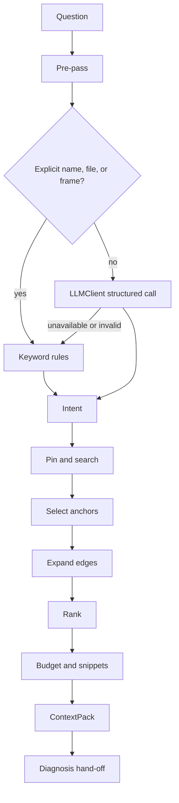

# Context agent

The context agent lives in `gatekeeper_graph.context`. It has two jobs:

1. Turn a question into an `Intent`.
2. Fetch a `ContextPack` from the graph and hand it to the diagnosis agent.

It does not diagnose, rank root causes, write an answer, or edit code.



## Contracts

`gatekeeper analyse --json` prints one `gatekeeper.analyse.v1` document. `fallback_reason` is null when the model answered, and a short reason when keyword rules were used instead.

`gatekeeper context --json` prints one `gatekeeper.context.v1` pack. The schema is `docs/contracts/context.v1.schema.json`. A failure prints `{"ok": false, "error": "..."}` and exits 2.

## Model

Every model call goes through `LLMClient.generate_structured`. The package default is the local Ollama client. Groq is the same client with environment settings, and the API key stays in the environment:

```powershell
$env:GATEKEEPER_LLM_PROVIDER = "langchain_groq"
$env:GATEKEEPER_LLM_MODEL = "qwen/qwen3.8-27b"
$env:GROQ_API_KEY = "<your key>"
uv run gatekeeper context <graph> "<question>" --root <repo> --json
```

Tests use `FakeClient`. Live-model tests are marked `ollama` and skip unless that Groq configuration is present.

## Degradation

Missing summaries, literals, `references` edges, `flows_into` edges, `search_index.json`, `changes.jsonl`, or `tests.json` do not stop the pack. Each one is listed in `gaps`. The model never creates node ids. A number it returns is kept only when it points at a shortlist row the code supplied. Pinned frames, backticks, and files stay selected.
